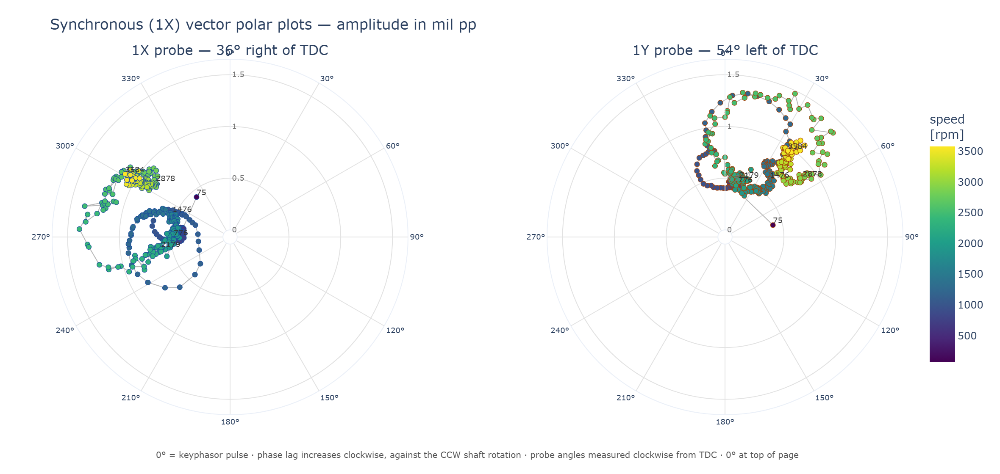
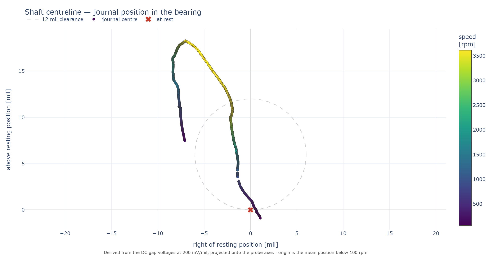

# RotorDyn - Vibration Data Viewer

A tool for reading Bently Nevada ADRE channel exports and plotting them as
polar (vector), Bode, trend and shaft centreline plots, with a live
transducer-rotation control that shows what each probe would read from any
other clock position.

It runs two ways from the same analysis core: a **desktop** application
(Tkinter + Matplotlib) and a **browser** application (Dash + Plotly) that
accepts uploaded files and gives hover readout, zoom and pan.



> **New to rotating machinery or to this codebase?** Read
> [`EXPLAINED.md`](EXPLAINED.md) first. It starts from what a vibration probe is
> and builds up to every line of the maths and every file of the code.

---

## 1. Running it

```bash
python -m pip install -r requirements.txt
python main.py
```

`main.py` looks for the ADRE exports in the current directory by default.
Other entry points:

| Command | What it does |
| --- | --- |
| `python main.py` | Launch the desktop application |
| `python main.py --web` | Serve the browser application on <http://127.0.0.1:8050> |
| `python main.py --buddy FILE [FILE ...]` | Rotor Buddy text + PDF (sync, async and/or static tabular) |
| `python main.py --mds FILE [FILE ...]` | MDS Engineer report: diagnosis + recommendations (also writes Rotor Buddy) |
| `python main.py --data path/to/exports` | Read the exports from another folder |
| `python main.py --summary` | Print what was found in the data and exit |
| `python main.py --export figures` | Render the static figure set (no display needed) |
| `python -m pytest tests -q` | Run the test suite |

Tested on Python 3.11 with numpy 2.2, pandas 2.3, matplotlib 3.9, dash 4.4 and
plotly 6.8. Tkinter ships with CPython on Windows and macOS; on Debian/Ubuntu
install `python3-tk`.

### The browser application

`python main.py --web` starts the viewer at <http://127.0.0.1:8050>. Drop the
ADRE exports for a machine onto the upload panel — one file per channel, 1X, 1Y
and keyphasor — or press **Load bundled sample data** to use the exports in the
repository. Every control described below works the same in both interfaces.

Deploying it for real means serving it through a production WSGI server rather
than the Flask development server:

```bash
python main.py --web 8050 --production --host 0.0.0.0   # waitress, any platform
gunicorn -w 4 -b 0.0.0.0:8050 wsgi:server               # Linux only
```

`--production` uses waitress, which unlike gunicorn runs on Windows — the
deployment host also runs ADRE Sxp, so it has to. One waitress process serves
every request from a thread pool, so the cache of parsed runs is shared and
nothing further is needed. Several gunicorn workers would instead need sticky
sessions, or that cache (`_RUNS` in `rotordyn/webapp.py`) moved to Redis.

[`DEPLOY.md`](DEPLOY.md) covers the Windows instance end to end: firewalls,
running as a service, locking down access, and cost.

### Rotor Buddy

`python main.py --buddy path\to\export.csv` runs the automated wiring, critical,
ISO, waterfall and bow checks and writes `outbox/rotor_buddy.txt` plus a graphed
`outbox/rotor_buddy.pdf`. Pass the sync timebase, async timebase and static
Tabular List together for the full set:

`python main.py --buddy new_1_1_5.csv async_data.csv static_1.csv`

[`ROTOR_BUDDY.md`](ROTOR_BUDDY.md) explains each check in plain language.

### MDS Engineer

`python main.py --mds path\to\export.csv` runs Rotor Buddy, then the MDS
Engineer agent: data-quality gate, malfunction catalog (whirl, rub, bow,
preload, thermal, unbalance), ISO severity, and a customer-style report.
It writes `outbox/mds_report.txt` and `outbox/mds_report.pdf`, plus the
Buddy checklist. Same three-file form as `--buddy`:

`python main.py --mds new_1_1_5.csv async_data.csv static_1.csv`

[`MDS.md`](MDS.md) is the operator guide. In the browser, open the **MDS Report**
tab after loading a channel set.

### The interface

* **Transducer rotation** - a 0-360° slider, a numeric entry box, and preset
  buttons. Both polar plots redraw as you drag. At 0° the plots show the
  measured data exactly.
* **Polar plots tab** - 1X and 1Y side by side, sharing a radial scale and a
  speed colour bar so the two probes are directly comparable. The track is
  coloured by shaft speed, labelled at evenly spaced speeds, and marked with a
  green circle at the first sample and a red square at the last.
* **Bode plot tab** - the same vectors as amplitude and phase against speed,
  which is where resonances are easiest to spot. The phase trace is broken
  wherever it wraps through 0°/360°, so a wrap cannot be mistaken for a real
  360° swing.
* **Trend tab** (web) - 1X amplitude, 1X phase, direct amplitude and gap voltage
  against time, with shaft speed overlaid on a second axis. This is the view
  that separates a speed-driven change from a time-driven one.
* **Shaft centreline tab** (web) - where the journal sits inside the bearing,
  reconstructed from the two DC gap voltages. Enter the diametral bearing
  clearance to draw the clearance circle.
* **Dataset & conventions tab** - what was loaded, the instrument status codes
  found, and the measured evidence for the rotation direction.
* **Run segment** - the record contains a startup, a 20-minute dwell at
  operating speed and a shutdown. A polar plot of a constant-speed dwell is
  meaningless, so the tool splits the record and plots one transient at a time.
* **Slow-roll compensation** - subtracts the averaged low-speed 1X vector
  (runout). On this dataset it changes the interpretation substantially; see
  `OBSERVATIONS.md`.
* **Machine view** - re-orients the polar plot so that 0° of phase sits at the
  probe's physical clock position instead of at the top of the plot, which is
  how a Bently polar plot is normally presented.

---

## 2. Conventions

These were the ambiguous parts of the brief. Each choice is stated here, is
applied consistently in the code, and is printed on every figure.

### Viewing direction

The brief does not say which end the machine is viewed from, so the view is
**defined by the data**: the end from which the export's own `Right` / `Left`
labels are true. Probe mounting angles follow the **machine drawings** (36°
right / 54° left of TDC), not the 45° / 45° values still printed in the ADRE
export metadata.

### Angular coordinate

Probe positions use **degrees from TDC, positive clockwise** (positive =
towards the right), matching how the export states them:

| Channel | ADRE export metadata | **Used in tool** (drawings) |
| --- | --- | --- |
| BRG1X | 45° Right | **+36°** |
| BRG1Y | 45° Left | **−54°** (= 306°) |
| Kph 1 | 100° Right | +100° |

1X and 1Y are 90° apart, so they are a genuine orthogonal pair, which is what
makes the rotation maths exact rather than approximate.

### Phase

Bently Nevada convention: phase is a **lag**, measured in degrees of shaft
rotation from the Keyphasor pulse to the positive peak of the 1X-filtered
signal. Larger phase = more lag. The export confirms the unit is `deg`.

### Rotation direction - measured, not assumed

The brief leaves the rotation sense open. Rather than pick one, it is inferred
from the data, two independent ways:

1. **Relative phase.** A probe further downstream in the direction of rotation
   sees the high spot later, so it reads a larger lag. Across 734 strong-signal
   samples, 1Y reads a median of **97° more lag than 1X** - close to the 90°
   physical separation, and positive. That places 1Y downstream of 1X. Going
   from 36° right of TDC toward 54° left of TDC the short way passes through TDC,
   which is **counter-clockwise** in this view.
2. **Forward/reverse orbit split.** Any synchronous orbit is the sum of a
   forward and a reverse circular component. Here the counter-clockwise
   component averages 0.396 against 0.046 clockwise, and dominates in **100%**
   of those samples. A rotor precesses predominantly in the direction of
   rotation, so the shaft turns counter-clockwise.

Both agree, and both agree with the `CCW ROTATION` marking on the reference
polar plot in the assignment. `python main.py --summary` reprints these numbers.

### Polar plot orientation

0° of phase is at the top and phase increases **clockwise**, i.e. against the
direction of rotation. This is the standard convention - plotting lag against
rotation makes the plotted vector point at the physical high spot. The
"Machine view" checkbox moves the 0° mark to the probe's own clock angle, which
is how the reference plot in the assignment is drawn.

---

## 3. The rotation maths

Because 1X and 1Y are orthogonal, their two phasors are the components of the
shaft's synchronous motion on an orthonormal basis of the transverse plane. A
probe anywhere else simply measures the projection of that motion onto its own
axis.

Write each reading as a phasor:

```
Z = (amplitude_pp / 2) · exp(-i · phase_lag)
```

so that the displacement towards the probe is `Re{Z · exp(i·Ω·τ)}` with `τ`
measured from the Keyphasor pulse - the peak then falls `phase_lag` degrees of
rotation after the pulse, which is exactly the lag convention above.

A probe at angle `θ` (clockwise from TDC) then reads

```
Z(θ) = cos(θ − 36°) · Z_1X  +  cos(θ − (−54°)) · Z_1Y
     = cos(θ − 36°) · Z_1X  +  cos(θ + 54°) · Z_1Y
```

and the displayed values are `amplitude_pp = 2·|Z(θ)|`,
`phase = (-arg Z(θ)) mod 360°`.

The rotation control moves **both** probes together by `r` degrees clockwise,
so the 1X plot is evaluated at `θ = 36° + r` and the 1Y plot at `θ = −54° + r`.
The pair therefore stays 90° apart and remains a valid probe pair at every
setting, and `r = 0` reproduces the measured data exactly.

Two things are worth noting about this formula:

* It is **exact for an elliptical orbit**. The common shortcut - "rotating a
  probe by `r` just shifts its phase by `r`" - is only true for a circular
  orbit. This formula reduces to that shortcut when the orbit is circular
  (there is a test for it) but stays correct when it is not.
* Because the orbits in this dataset are nearly circular, rotating the pair by
  +90° visibly moves the 1X pattern onto the 1Y plot and vice versa (inverted,
  since the rotated 1X probe then sits diametrically opposite the original 1Y).
  That is an easy sanity check to make in the interface, and it is asserted in
  the test suite.

Slow-roll compensation subtracts a constant vector from `Z_1X` and `Z_1Y`
before the projection. Since both operations are linear the order does not
matter, but doing it first is simpler.

### The shaft centreline maths

The same probe geometry works on the DC gap voltages, and gives the shaft
centreline plot for free. The proximitors output roughly **−200 mV/mil**, and
the voltage grows *more negative* as the gap widens, so a rising voltage means
the shaft has moved *towards* that probe:

```
d = (V − V_rest) / 0.200          mils towards the probe
```

Because the two probe axes are perpendicular they form an orthonormal basis, so
the journal's position is just the sum of each probe's displacement along its
own axis:

```
position = d_1X · u(36°)  +  d_1Y · u(−54°)          where u(θ) = (sin θ, cos θ)
```

`V_rest` is the mean gap below 100 rpm, where the journal lies at the bottom of
its clearance. The plot puts that point at the origin.



On this dataset the journal rises about 13 mils and moves about 3 mils to the
**left** as the machine comes up to speed. That is what a fluid-film bearing
does — the oil wedge lifts the journal and leans it in the direction of
rotation — and the lean being to the left is an independent confirmation of the
counter-clockwise rotation that was worked out from the phase data in §2.

Two caveats this plot cannot resolve on its own:

* **The 200 mV/mil scale factor is an assumption.** It is the standard for a
  Bently 3300 XL 8 mm system but is not stated anywhere in the export. Every
  distance on this plot scales linearly with it.
* **Gap change is not only position change.** The trend plot shows both gap
  voltages continuing to drift during the constant-speed dwell, long after the
  journal has finished lifting, which is thermal growth of the machine and its
  probe mountings rather than movement of the shaft in the bearing. Centreline
  plots always carry this ambiguity.

---

## 4. What the data turned out to be

The three `.csv` files are not CSV. They are **UTF-16LE, tab-delimited** ADRE
exports containing two stacked tables: a one-row channel metadata block
(channel name, mounting angle, direction, units) followed by the sample table.
Nothing about this is documented in the brief, so the reader:

* tries UTF-16, UTF-8 and cp1252 in turn and rejects any decode that leaves NUL
  bytes behind;
* locates both tables by finding the two `CH#` header rows rather than by fixed
  line numbers;
* identifies the channels **from their own metadata**, not from the file names -
  the keyphasor is the channel that reports speed and carries no 1X vector, and
  the two probes are told apart by the sign of their mounting angle. Renaming
  the files changes nothing.

### Numeric cells carry status codes

Many numeric cells have a vendor status code glued directly onto the number
with no separator, e.g. `0.083K25`, `280BMA`, `2FNX`. Naive parsing turns these
into NaN and silently loses data. The reader splits each cell into a value and
a flag, keeping both.

The codes are not explained anywhere in the material, so their meanings were
inferred from where they occur, and each inference is checkable:

| Code | Count | Where it occurs | Reading |
| --- | --- | --- | --- |
| `K25` | 2 samples | The first two samples, where speed jumps 0 → 62 rpm | Keyphasor speed changed by more than 25% between samples. The reference polar plot in the assignment carries the printed note *"KEYPHASOR CHANGE BY MORE THAN 25%"*, which is what pinned this one down. |
| `BMA` | 44 samples | Only on **phase** cells, and only where amplitude is 0.036-0.097 mil pp | Below minimum amplitude - there is not enough signal for the phase to mean anything. |
| `A1H` | 23 samples | Only at 8.8-60 rpm, at the very end of the coast-down | Below the minimum speed for valid 1X vector processing. |
| `FNX` | - | `nX-1 Phase` only, a channel not used here | nX filter not tracking. |

By default the tool hides samples carrying any of these flags on the 1X
amplitude or phase; the checkbox turns that off.

### Speed

Speed comes from the `Speed` column of the keyphasor channel, as the brief
asks. As a cross-check, the `Speed(P)` column in both probe files matches it
exactly on all 1051 samples. `Speed(S)` is zero throughout and is ignored.

The three files share identical `Sample#` and `Date` columns, so the channels
are aligned on `Sample#` (an inner join) rather than on timestamps.

---

## 5. Assumptions

1. **Viewing end.** Not stated in the brief, so it is defined as the end that
   makes the export's Right/Left labels true. Everything is expressed in that
   view, so the analysis is internally consistent either way.
2. **Rotation direction.** Inferred from the data as counter-clockwise in that
   view (Section 2). Not assumed.
3. **Probe mounting angles.** The ADRE channel metadata still lists 45° right /
   45° left. Per the machine drawings, the tool uses **36° right (1X)** and
   **54° left (1Y)** for all projection and rotation maths (`PROBE_1X_DEG` /
   `PROBE_1Y_DEG` in `rotordyn/vectors.py`). The probes remain 90° apart.
4. **Probe polarity.** Both probes are assumed to use the standard convention,
   positive signal = shaft moving towards the probe. The projection maths needs
   the two probes to share a polarity convention; they are the same channel
   type on the same bearing, so this is safe.
5. **Rotation control semantics.** "Enter an angle 0-360°" is read as *rotate
   the probe pair by that angle*, so 0° reproduces the measured data and the two
   plots stay distinct. Reading it as an absolute mounting angle applied to both
   probes would put them in the same place and make the two plots identical.
   The underlying function takes an absolute angle, so that reading is one call
   away if it was the intended one.
6. **Amplitude units.** Taken from the export metadata (`mil pp`) rather than
   hard-coded, and shown on the plots. Gap voltages are converted to mils at the
   standard 200 mV/mil proximity probe scale factor for the write-up only.
7. **Slow-roll window.** Defaults to 300-700 rpm, well below the first
   resonance and above the speeds where the keyphasor flags data as invalid.
   The window is editable in the interface.
8. **Segment split.** The record is cut on the first and last time the machine
   reaches 99% of its maximum speed, which isolates the two transients from the
   constant-speed dwell between them.

---

## 6. Layout

```
main.py                  entry point (desktop, --web, --buddy, --mds, --summary, --export)
wsgi.py                  WSGI entry point for gunicorn
analysis.py              produces the numbers quoted in OBSERVATIONS.md
rotordyn/
    adre.py              ADRE export reader: encodings, two-table layout, status codes
    dataset.py           channel classification, alignment on Sample#, run segmentation
    vectors.py           phasors, probe projection, precession split, slow-roll
    waveforms.py         streaming timebase dumps, FFT harmonics
    buddy.py             Rotor Buddy checks (Kiran Toram scope v001)
    mds.py               MDS Engineer agent (diagnosis + recommendations)
    mds_pdf.py           customer-facing MDS PDF
    centreline.py        gap volts -> journal position inside the bearing
    model.py             control state -> plot-ready arrays (no interface dependency)
  --- desktop ---
    plots.py             Matplotlib polar and Bode figures
    gui.py               Tkinter interface
    export.py            headless figure rendering
  --- browser ---
    webplots.py          Plotly polar, Bode, trend and centreline figures
    webapp.py            Dash interface
tests/
    test_vectors.py      the rotation maths
    test_pipeline.py     parsing, alignment and the view model
    test_gui_smoke.py    the desktop window builds and reacts to the angle control
    test_web.py          centreline maths, uploads, web figures, the Dash app
    test_buddy.py        Rotor Buddy FFT, swapped-probe and scale-factor checks
    test_mds.py          MDS diagnosis, condition rating and PDF
tools/
    preview_web_figures.py   render each web tab to PNG
    normalise_encoding.py    rewrite any UTF-16 source file as UTF-8
EXPLAINED.md             from-scratch walkthrough: the physics, the maths, the code
ROTOR_BUDDY.md           how Rotor Buddy implements each scope check
MDS.md                   MDS Engineer agent: diagnosis, report, what it will not do
OBSERVATIONS.md          what the data shows
figures/                 rendered by `python main.py --export figures`
figures/web/             rendered by `python tools/preview_web_figures.py`
```

The maths, the data handling and the interfaces are separate. `model.py` turns
control state into arrays without importing anything interface-related, which
is what lets the test suite, the headless export, the desktop window and the
web application all exercise one code path. Adding the browser front end
touched no analysis code: it needed a Plotly rendering layer, a Dash control
layer, and two small additions to let exports arrive as bytes rather than as a
directory (`load_channel_bytes`, `build_run_from_channels`).

### Tests

134 tests, roughly:

* **Rotation maths** - identities at 0° and 360°, the pair staying orthogonal,
  the 90° swap, a probe 180° away reading the negated signal, a circular orbit
  reducing to a pure phase shift, an elliptical orbit *not* doing so, and
  straight-line motion projecting to zero on its perpendicular.
* **Parsing** - value/flag splitting, UTF-16 and UTF-8 exports, Right/Left angle
  signs, malformed files rejected, built against a synthetic export so they run
  without the dataset.
* **Pipeline on the real data** - channel identification, alignment, segment
  bounds, and that a 0° rotation reproduces the exported amplitude and phase
  columns to within 1e-9.
* **Desktop interface** - the window builds, typed and out-of-range angles are
  handled, every segment renders, and moving the control changes both plots.
* **Shaft centreline** - the gap-to-mils sign and scale, that no gap change
  leaves the journal at the origin, that motion along one probe axis lands on
  that axis, and that the real shaft lifts and leans the way a fluid-film
  bearing makes it lean.
* **Uploads** - bytes and path loaders agree, an upload rebuilds a run identical
  to the one read from disk, and unreadable files raise rather than crash.
* **Web interface** - every tab produces a figure, rotation reaches the polar
  titles, machine view moves the angular axis to the probe, an impossible filter
  gives a placeholder rather than an exception, the page and callbacks serve,
  and the web and desktop paths compute identical numbers.
